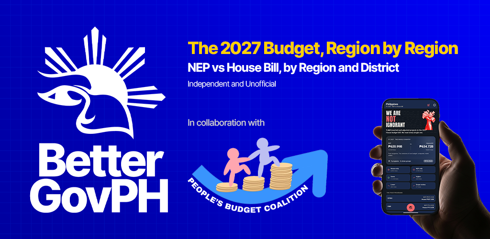
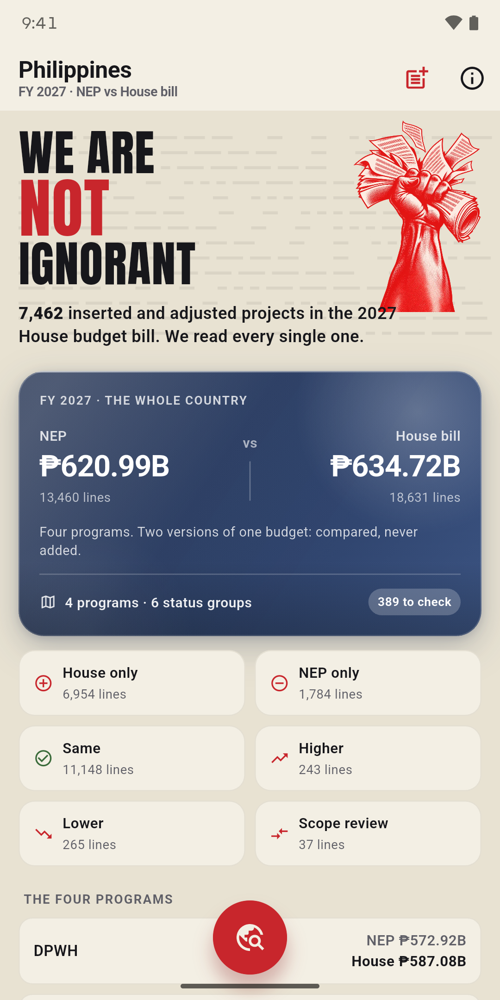
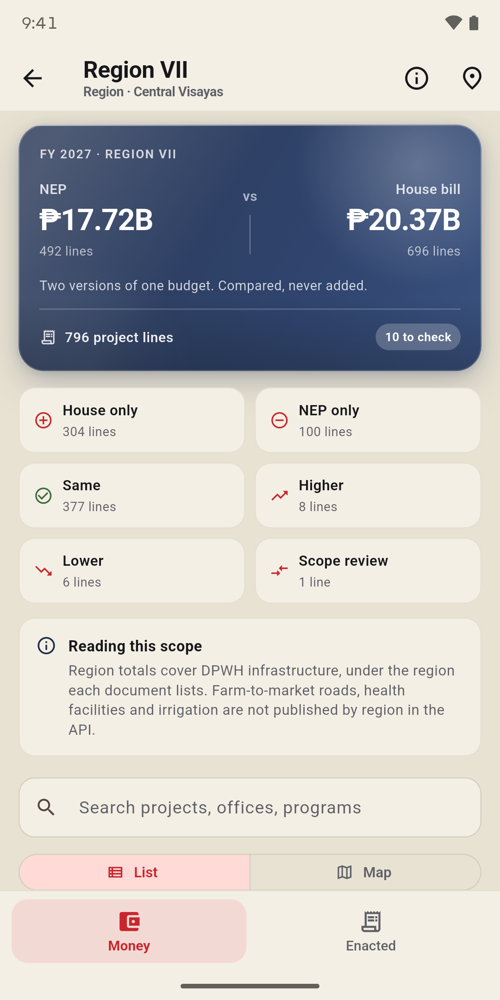
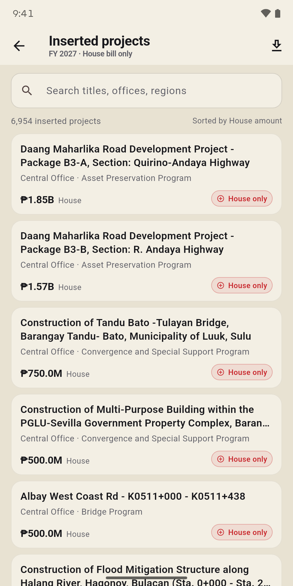
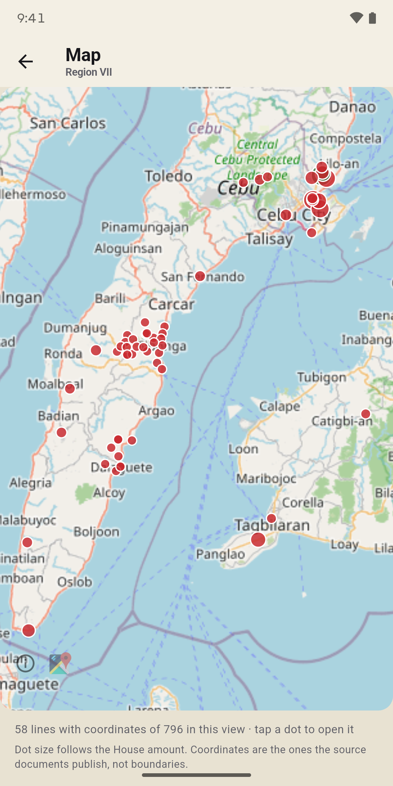
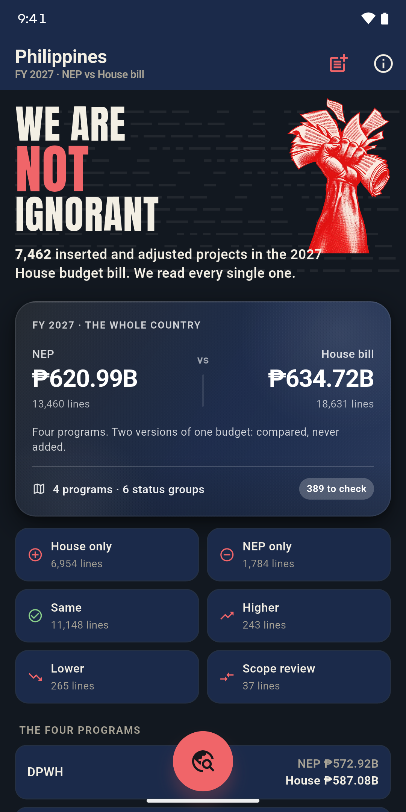
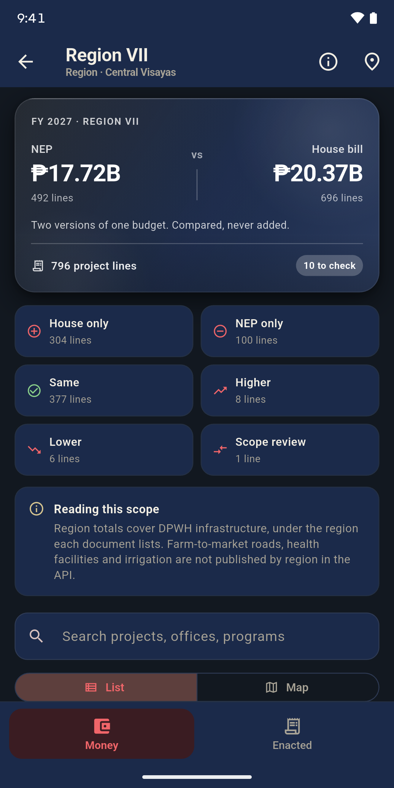
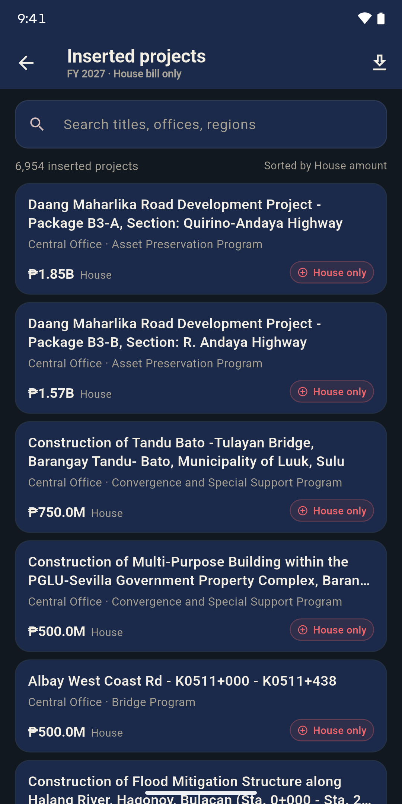
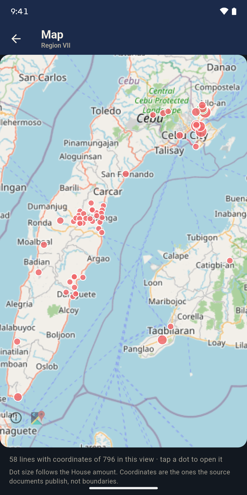

# BetterGov Budget (mobile)



A mobile view of the [BetterGov.ph budget transparency portal](https://budget.bettergov.ph)
for **every place in the Philippines**: the 18 regions, and inside them the 254
legislative districts. Each view answers what the place gets in FY 2027 under the NEP and
under the House bill, with the page each figure is on, and what has been enacted for it
since 2020.

## Screenshots

From the 1.0.2 (3) release build on a Moto G75 5G. Both themes share one layout; only the
colours change.

| National totals | A region | Inserted projects | Map |
| --- | --- | --- | --- |
|  |  |  |  |
|  |  |  |  |

All eight screens in each theme: [light](docs/store/screenshots/light) ·
[dark](docs/store/screenshots/dark).

## Download

Install the app from the signed release APK published on the
[**Releases page**](https://github.com/greenarmor/phtransparency-mobile/releases):

- **[bettergov-budget-v1.0.1.apk](https://github.com/greenarmor/phtransparency-mobile/releases/download/v1.0.1/bettergov-budget-v1.0.1.apk)** (57.3 MB)

Verify the download against the published SHA-256 before installing:

```sh
shasum -a 256 bettergov-budget-v1.0.1.apk
# 1d4df989bacd80e536a555c37e315c8fd395625a2c6588711c16d68ed404094f
```

The same checksum is attached to the release as
[`bettergov-budget-v1.0.1.apk.sha256`](https://github.com/greenarmor/phtransparency-mobile/releases/download/v1.0.1/bettergov-budget-v1.0.1.apk.sha256)
and kept in this repo as [`releases/bettergov-budget-v1.0.1.apk.sha256`](releases/bettergov-budget-v1.0.1.apk.sha256).
The APK is signed (`CN=BetterGov Budget`, APK Signature Scheme v2); Android will ask
you to allow installs from this source on first run.


## What's new in 1.0.1

- **Campaign welcome** - the app opens on the *WE ARE NOT IGNORANT* poster, on the
  cream, ink, red and navy palette, with the live inserted-and-adjusted count.
- **Inserted projects** - a red app-bar action opens every House-bill-only line across
  the four programs, with a search box, a lazy list, and a download of the published
  changes CSV.
- **Status colours** - any changed group reads red; only "same amount in both" is green.
- The old campaign route and page are gone: the flow is welcome, then the budget.


## GAA browser (2020–2026)

An app-bar action on the national screen opens the enacted-budget browser, the mobile
twin of the [transparency dashboard's budget pages](https://transparency.bettergov.ph/budget):

- **Browser home** (`/gaa`) - the seven-year enacted trend, a searchable list of all
  38 departments with their seven-year bars and share of the chosen year.
- **Year page** (`/gaa/:year`) - one fiscal year from `/gaa/years/{year}`: the national
  total, line-item count, and every department with its exact share.
- **Department page** (`/gaa/:year/departments/:id`) - agencies and bureaus, the
  PS/MOOE/FinEx/CO expense-class breakdown, and the department's seven-year history.
- **Hierarchy drill** (`…/children`) - the same walk the dashboard does: agency →
  program (P/A/P) → operating unit → fund → expense class, one level per page.
- **By region** (`/gaa/regional`) - a second source: the transparency dashboard's
  regional GAA aggregate (DBM-derived). 2020 is only partly broken out and 2026 is not
  published there yet; unknown-region buckets are shown separately, never summed into
  a region.

## Coverage

- **All Philippines** - national totals for the four project programs, the six status
  groups, and all 18 DPWH regions.
- **Region** - every DPWH line under that region, compared across versions.
- **Legislative district** - the DPWH ledger of every office that serves the district.
  Shared (Tier B) offices are shown whole and never split.
The place search is region-only on purpose: the API has no city or municipality
dimension, so a name search would mix every line that merely mentions the words (Cebu
City pulling in Mandaue, Lapu-Lapu and even NCR) and the totals would be wrong.

## Data

No backend and no database. Everything comes from the public, read-only, CORS-open
[BetterGov.ph Budget API](https://budget.bettergov.ph/docs):

| Request | Used for |
| --- | --- |
| `/api/v1/hgab/2027` | National totals, six status groups, rules, notices, disclaimers, source commit |
| `/api/v1/hgab/2027/datasets/dpwh/regions` | The 18 regions, NEP vs House |
| `/api/v1/hgab/2027/districts?q=…` | The 254 legislative districts, searchable |
| `/api/v1/hgab/2027/districts/{id}` | A district's offices, representative, history |
| `/api/v1/hgab/2027/datasets/{program}/projects?office=…` | Every DPWH line under an office, paged 200 at a time |
| `/api/v1/hgab/2027/datasets/{program}/projects?q=…` | Every 2027 line whose title names a place |
| `/api/v1/hgab/2027/datasets/{program}/projects/{id}` | One project: amounts, pages, match and reading labels |
| `/api/v1/gaa` + `/gaa/departments` | National enacted totals and the 38 departments |
| `/api/v1/gaa/years/{year}` | One year: national total and every department's share |
| `/api/v1/gaa/departments/{id}` | Department detail: agencies and expense classes |
| `/api/v1/gaa/years/{year}/departments/{id}/children?level=…&parent=…` | The hierarchy drill, one level per call |
| `transparency.bettergov.ph/data/bir/aggregates/gaa_by_region.json` | Regional GAA allocations (DBM-derived, the dashboard's own source) |

The API republishes an independent reading of the published NEP, House Bill 10858 and
the DBM General Appropriations Acts. Host override: `--dart-define=API_BASE=…`.

## Offline behaviour

The remote API is always the source of truth — every screen fetches over the network
first, so any upstream data update is picked up on the next load or pull-to-refresh.
Each successful response is also persisted to a local file cache
(`api-cache/` under the app-support directory, `lib/core/network/cache_store.dart`).
When the API cannot be reached (connection errors, timeouts, 5xx), the last saved
response for that exact request is served instead, and the app bar shows a
cloud-off icon. Real answers — 400/404 and friends — are never masked by cache, and a
recovered connection immediately clears the flag and overwrites the cache with the
newer body. There is no expiry: a cache is only ever replaced by a newer remote copy.

## Rules the app keeps

- Amounts are integer pesos as published. A dash means "this document has no such
  line", never zero.
- NEP and House bill are two versions of one budget: **compared, never added**.
- "In the House bill only" and "in the NEP only" are **candidates**, not confirmed
  changes.
- A shared DPWH office is shown whole; its money is never split between districts.
- Enacted amounts are appropriations (authority to spend, not spending); a year counts
  only where the amount is above zero.
- Disclaimers are printed from the API response itself.

## Known limits

- The API places DPWH money by **office**, and other lines by the place their **title**
  names. It does not yet say which city or municipality a project is in, so a district
  view is the offices' ledger, and there is no city-level view to offer.
- The GAA (2020–2026) has no region filter; a region view shows national totals, stated
  on the screen.
- Region totals cover DPWH infrastructure only; the other three programs are not
  published by region.

## Run

```bash
flutter pub get
flutter run                      # device or simulator
dart analyze                     # static checks
flutter test                     # unit tests
flutter build apk --debug        # Android
flutter build ios --debug --no-codesign
```

## Structure

```
lib/
  core/config/       API host, fiscal year, years
  core/firebase/     Crashlytics bootstrap, Analytics events
  core/network/      Dio client and error mapping
  core/theme/        BetterGov tokens, Material 3 theme
  core/utils/        pesos, dates, status labels
  data/models/       API shapes, place selection (national/region/district/named)
  data/services/     budget_api (paging), scope_service, gaa_service
  providers/         Riverpod providers, saved place
  router/            GoRouter (national, region tabs, place, project)
  presentation/      region shell, circle button, place sheet, screens
```

## Firebase (bring your own project)

Analytics and Crashlytics are optional here: the app is not bound to a committed
Firebase project, and every generated Firebase file is gitignored. A fresh clone builds
and runs as is; without `android/app/google-services.json` the Android build skips the
Firebase Gradle plugins and the app runs with Analytics and Crashlytics off.

1. Create a Firebase project and register an Android app with the package
   `ph.bettergov.budget` (and an iOS app with the same bundle id).
2. From the repo root run `flutterfire configure`. The app reads the platform files it
   writes, `android/app/google-services.json` and `ios/Runner/GoogleService-Info.plist`
   (`Firebase.initializeApp()` with no Dart options); the `lib/firebase_options.dart` it
   also writes is not used.
3. Templates for a hand-written setup: `android/app/google-services.example.json`,
   `ios/Runner/GoogleService-Info.example.plist`.
4. Only if you use Hosting or App Distribution, add your own `firebase.json` and
   `.firebaserc` (also gitignored).

- **Crashlytics**: initialised in `main.dart`; uncaught Flutter and platform errors are
  recorded as fatal. Collection stays off in debug builds.
- **Analytics**: `project_open` (dataset + line id) and `tab_open` events, in
  `lib/core/firebase/analytics.dart`.
- **App Distribution**: create a tester group in your Firebase console, then
  `firebase appdistribution:distribute build/app/outputs/flutter-apk/app-release.apk --app <your-app-id>`.

Firebase failures never block the budget screens: initialisation is guarded.

## Security notes

- **Android hardening** - `android:allowBackup="false"` with `fullBackupContent="false"`
  and `res/xml/data_extraction_rules.xml` (prefs, databases and files excluded), and
  `android:usesCleartextTraffic="false"`. The only exported components are `MainActivity`
  (launcher) and AndroidX's `ProfileInstallReceiver`, which is guarded by
  `android.permission.DUMP`.
- **Permissions** - the app itself asks only for `INTERNET`. The advertising-ID permissions
  that Firebase Analytics merges into the manifest are removed with `tools:node="remove"`:
  the app shows no ads and never reads the advertising ID.
- **Release signing** - the upload keystore lives outside git
  (`android/app/upload-keystore.jks` + `android/key.properties`, both ignored). Keep a
  backup: without it you cannot publish an update. Without `key.properties` a release
  build falls back to the debug key, and Gradle warns that it must not be published.
- **Links** - every URL that comes from the API is opened through
  `openExternal()` (`core/utils/links.dart`), which only hands `http`/`https` to the
  platform, so a `javascript:`/`intent:`/`file:` URL cannot reach another app.
- **Telemetry** - Analytics and Crashlytics start disabled in debug builds; events carry
  a dataset name, a line id and a tab name, never a place, account or device identifier.
- **No other secrets** - the only credentials in the repo are Firebase *client*
  identifiers (`google-services.json`, `GoogleService-Info.plist`), and both stay out of
  git. Restrict them in the Google Cloud console to the Android
  package `ph.bettergov.budget` (plus the release SHA-1) and the iOS bundle id, and turn on
  App Check.
- No deep links, no WebView, no file writes; the only local storage is the theme choice.

## App icon

The launcher icon is the BetterGovPH tile: the white mark and wordmark on a blue diagonal
gradient. `assets/images/app_icon_512.png` is the 512 px master (also the store-listing
icon); every other size is generated from it.

- **Android 8+** - an adaptive icon, `mipmap-anydpi-v26/ic_launcher.xml`, with two layers
  per density at 108/162/216/324/432 px: `ic_launcher_background.png` (the gradient,
  continued to the edge of the 108 dp canvas) and `ic_launcher_foreground.png` (the white
  mark on transparent). The mark's farthest pixel sits on the 33 dp radius of the safe zone,
  so no launcher mask clips it, and the visible icon keeps the master's proportions. The
  foreground doubles as the monochrome layer for Android 13+ themed icons.
- **Android 7** - the master as a square `mipmap-*/ic_launcher.png` at 48/72/96/144/192 px.
- **iOS** - all 15 `AppIcon.appiconset` files, opaque. The 1024 px marketing icon is drawn
  from a 2x upscale of the mark over a full-size gradient; replace it from a 1024 px master
  when one exists.

Regenerate them all from the master whenever the tile changes.

## Store listing images

`docs/store/` holds the Google Play graphics. They are not bundled into the app.

- `feature-graphic.png`: the 1024 × 500 feature graphic.
- `screenshots/light/` and `screenshots/dark/`: eight 1080 × 2160 phone screenshots per
  theme, 24-bit PNG with no alpha, numbered in listing order. Play takes up to eight, so
  upload one theme's set. Both were captured on a device at the same scroll positions, with
  a fixed 9:41 status bar, so the two sets match screen for screen.
- The store icon is the 512 px master, `assets/images/app_icon_512.png`.

Retake the screenshots whenever a captured screen changes, so the listing shows the app as
it is.
